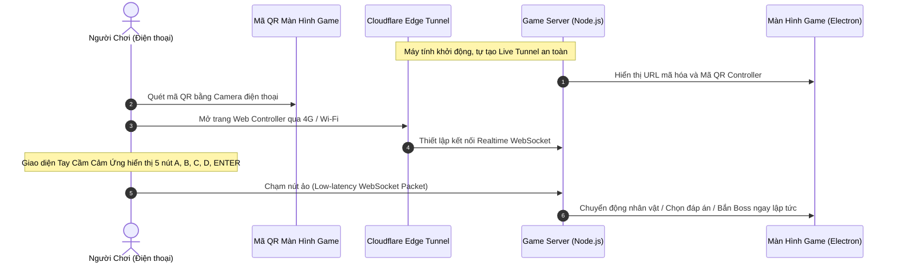

<div align="center">

# 🛡️ VỆ BINH MẬT KHẨU
### CYBERSEC PASSWORD GUARDIAN • PHIÊN BẢN 3.0.1 (CROSS-PLATFORM EDITION)

**HỆ THỐNG TRÒ CHƠI GIÁO DỤC AN TOÀN THÔNG TIN TƯƠNG TÁC ĐA NỀN TẢNG**  
*Sự kết hợp độc đáo giữa Nghệ thuật Retro Pixel 16-bit, Phần cứng Vật lý Arduino & Điều khiển Di động Thời gian thực*

---

[](https://github.com/petertuananh/CyberSecGame/releases/tag/v3.0.1)
[](https://github.com/petertuananh/CyberSecGame/releases)
[](https://www.arduino.cc/)
[](https://www.electronjs.org/)
[](https://github.com/petertuananh/CyberSecGame)
[](LICENSE)

<br/>

> 🏛️ **ĐƠN VỊ ĐỒNG HÀNH VÀ BẢO TRỢ CHUYÊN MÔN**  
> **TRƯỜNG THCS NGUYỄN BỈNH KHIÊM** &nbsp;×&nbsp; **PHÒNG NGHIÊN CỨU & PHÁT TRIỂN SOFTLAB**  
> *Sản phẩm đổi mới sáng tạo phục vụ công tác giảng dạy, trải nghiệm số và ngày hội an toàn không gian mạng.*

---

</div>

<br/>

## 📥 CỔNG TẢI VỀ BẢN CÀI ĐẶT CHÍNH THỨC (RELEASE v3.0.1)

Hệ thống hỗ trợ gói cài đặt nguyên bản cho tất cả các hệ điều hành máy tính phổ biến hiện nay:

| Hệ Điều Hành | Kiến Trúc Vi Xử Lý | Định Dạng Tệp | Liên Kết Tải Nhanh | Hướng Dẫn Nhanh |
| :--- | :--- | :---: | :---: | :--- |
| 🍏 **macOS** | **Apple Silicon (M1, M2, M3, M4)** | `.dmg` | [**Tải CyberSecGame-macOS-arm64.dmg**](https://github.com/petertuananh/CyberSecGame/releases/download/v3.0.1/CyberSecGame-macOS-arm64.dmg) | Mở file `.dmg`, kéo biểu tượng game vào thư mục `Applications`. |
| 💻 **macOS** | **Intel Core (x64)** | `.dmg` | [**Tải CyberSecGame-macOS-x64.dmg**](https://github.com/petertuananh/CyberSecGame/releases/download/v3.0.1/CyberSecGame-macOS-x64.dmg) | Tương thích toàn bộ máy Mac dùng CPU Intel 64-bit. |
| 🪟 **Windows** | **Windows 10 / 11 (64-bit)** | `.exe` | [**Tải CyberSecGame_Setup.exe**](https://github.com/petertuananh/CyberSecGame/releases/download/v3.0.1/CyberSecGame_Setup.exe) | Trình cài đặt tự động tạo icon Desktop & Start Menu. |
| 📦 **Windows Portable** | **Không cần cài đặt** | `.zip` | [**Tải CyberSecGame-Windows-x64.zip**](https://github.com/petertuananh/CyberSecGame/releases/download/v3.0.1/CyberSecGame-Windows-x64.zip) | Giải nén vào USB và chạy trực tiếp mọi nơi. |

> [!TIP]
> **Tính năng Tự Động Cập Nhật 1-Click (In-App Auto Update):**  
> Khi đang mở game, nếu có phiên bản mới, hệ thống sẽ phát tín hiệu thông báo. Người dùng chỉ cần nhấp **`CẬP NHẬT TRỰC TIẾP (1-CLICK)`**:
> * **Trên macOS:** Tự động phát hiện chip Apple Silicon hay Intel, tải đúng bản `.dmg` và kích hoạt Finder để người dùng cài đặt tức thì.
> * **Trên Windows:** Tự động kích hoạt hộp thoại Quản trị viên (UAC) để ghi đè phiên bản mới mà không làm mất dữ liệu người chơi.

---

## 💎 TỔNG QUAN DỰ ÁN & TẦM NHÌN PHÁT TRIỂN

**Vệ Binh Mật Khẩu (CyberSec Password Guardian)** là một giải pháp giáo dục an ninh mạng mang tính đột phá, chuyển hóa các khái niệm an toàn số trừu tượng (như độ dài mật khẩu, xác thực hai yếu tố 2FA, tấn công vét cạn Brute-force, rò rỉ dữ liệu Data Breach, và lừa đảo Phishing) thành một **hành trình phiêu lưu nhập vai (RPG Adventure)** đầy hấp dẫn.

### 🌟 6 Trụ Cột Đột Phá Công Nghệ

```
                                  ┌─────────────────────────────────────────┐
                                  │   VỆ BINH MẬT KHẨU v3.0.1 (CORE ENGINE) │
                                  └────────────────────┬────────────────────┘
                                                       │
         ┌───────────────────┬─────────────────────────┼─────────────────────────┬───────────────────┐
         │                   │                         │                         │                   │
         ▼                   ▼                         ▼                         ▼                   ▼
┌─────────────────┐ ┌─────────────────┐       ┌─────────────────┐       ┌─────────────────┐ ┌─────────────────┐
│  4 KÊNH ĐIỀU    │ │ RETRO ARCADE    │       │ 100% RANDOMIZED │       │ DUAL SIGNED     │ │ DEEP HELPER &   │
│  KHIỂN VẬT LÝ   │ │ & DYNAMIC CLIME │       │ QUESTION MATRIX │       │ CERTIFICATE     │ │ REALTIME SYNC   │
│  - Arduino 5-Btn│ │ - 16-bit Pixel  │       │ - Đề bài ngẫu   │       │ - Dấu mộc & chữ │ │ - Soạn đề thi   │
│  - Live Phone QR│ │ - 4 mùa thời    │       │   nhiên theo màn│       │   ký THCS NBK   │ │ - Điểm thưởng   │
│  - Gamepad USB  │ │   tiết thực tế  │       │ - Sinh dữ liệu  │       │ - Chữ ký chuẩn  │ │ - WebSocket     │
│  - Mouse/Canvas │ │ - Tự đổi trang  │       │   mật mã tự động│       │   SoftLab R&D   │ │   đồng bộ nóng  │
│    tương tác cao│ │   phục nhân vật │       │ - Chống học vẹt │       │ - In PNG / PDF  │ │ - Xuất/Nhập JSON│
└─────────────────┘ └─────────────────┘       └─────────────────┘       └─────────────────┘ └─────────────────┘
```

1. **Đa Nền Tảng Toàn Diện (Native Cross-Platform):** Chạy mượt mà trên cả Windows (Setup Installer/Portable) và macOS (Native `.app` và `.dmg` chuẩn Apple Silicon & Intel).
2. **Hệ Thống 4 Kênh Điều Khiển Độc Quyền:**
   * **Bàn điều khiển vật lý Arduino:** 5 nút bấm Arcade cỡ lớn siêu nhạy, độ trễ xấp xỉ 0ms.
   * **Tay cầm Ảo trên Smartphone (Live Cloudflare Tunnel):** Người chơi chỉ cần quét mã QR bằng camera điện thoại để biến màn hình cảm ứng thành tay cầm Arcade qua kết nối mạng không dây (4G/Wi-Fi).
   * **Tay cầm Gamepad / Joystick:** Tương thích chuẩn Gamepad API cho các loại tay cầm USB / Bluetooth.
   * **Bàn phím & Chuột tương tác Canvas:** Trải nghiệm điều khiển toàn diện trực tiếp trên màn hình game.
3. **Môi Trường Thời Tiết Biến Đổi Tức Thì (Dynamic Climatic Engine):**
   * Tự động luân chuyển giữa 4 trạng thái thời tiết: **Nắng rực rỡ**, **Mưa rào**, **Tuyết lạnh**, và **Bão tố sấm sét**.
   * Nhân vật chính tự động thay đổi trang phục thích ứng: Đội nón lá, che dù hoa văn cổ điển, hoặc mặc áo lông ấm áp. Cảnh quan môi trường (mặt nước, bóng đổ, lá rơi) phản ứng sinh động.
4. **Ngân Hàng Dữ Liệu Bảo Mật Sinh Tự Động (Procedural Cybersecurity Matrix):**
   * Các chuỗi mật khẩu mục tiêu, tên người dùng, trường hợp tấn công phishing đều được sinh ngẫu nhiên 100% trong mỗi lượt chơi, ngăn chặn hoàn toàn việc ghi nhớ máy móc.
5. **Chứng Nhận Vinh Danh Kép (Dual Signed Certificate of Honor):**
   * Người chơi sau khi phá đảo sẽ được trao tặng Bằng Khen An Ninh Mạng trang trọng.
   * Tích hợp chữ ký độ nét cao nguyên bản của **Hiệu trưởng Trường THCS Nguyễn Bỉnh Khiêm** và **Đại diện Phòng R&D SoftLab**, kèm tem vàng chứng thực và mã QR truy xuất kết quả.
6. **Bảng Quản Trị Sâu Dành Cho Giáo Viên & Ban Tổ Chức (Deep Helper Dashboard):**
   * Giao diện trực quan tại `/helper` cho phép thêm bớt vòng chơi, biên soạn câu hỏi, gắn trọng số hoa hồng thưởng riêng cho từng câu, cân chỉnh máu Boss và đồng bộ tức thì vào màn hình game không cần khởi động lại.

---

## 🗺️ BẢN ĐỒ TIẾN TRÌNH TRÒ CHƠI (GAME ARCHITECTURE)

Hành trình được thiết kế theo cấu trúc thử thách tăng tiến, kết hợp giữa rèn luyện tư duy logic, phản xạ nhanh và kiến thức thực tiễn:

```mermaid
flowchart TD
    %% Khởi tạo phong cách
    classDef startNode fill:#1e1b4b,stroke:#818cf8,stroke-width:2px,color:#fff;
    classDef storyNode fill:#312e81,stroke:#a5b4fc,stroke-width:2px,color:#fff;
    classDef stageNode fill:#064e3b,stroke:#34d399,stroke-width:2px,color:#fff;
    classDef minigameNode fill:#78350f,stroke:#fbbf24,stroke-width:2px,color:#fff;
    classDef bossNode fill:#7f1d1d,stroke:#f87171,stroke-width:3px,color:#fff;
    classDef rewardNode fill:#701a75,stroke:#f472b6,stroke-width:2px,color:#fff;
    classDef failNode fill:#374151,stroke:#9ca3af,stroke-width:2px,color:#fff;

    Start["🚀 BẮT ĐẦU TRÒ CHƠI<br/>(Nhập Tên Hiệp Sĩ • Nút ENTER / A)"]:::startNode
    Start --> Story["📖 CỐT TRUYỆN MỞ ĐẦU (5 HỒI)<br/>Âm thanh gõ máy chữ 8-bit • Bỏ qua: ESC / Nhấp chuột"]:::storyNode

    Story --> S1["🌲 VÒNG 1: KHU RỪNG MẬT MÃ<br/>Độ dài, ký tự đặc biệt, rủi ro ngày sinh"]:::stageNode
    S1 --> S1_Eval{"Đạt chuẩn điểm số?"}
    S1_Eval -- "Đạt" --> Dice1["🎲 LẮC XÚC XẮC THẦN KỲ 1"]:::minigameNode
    S1_Eval -- "Chưa đạt" --> S1_Fail["Thử thách lại Vòng 1"]:::failNode
    S1_Fail --> S1

    Dice1 --> D1_Branch{"Kết quả gieo?"}
    D1_Branch -- "Số LẺ (1, 3, 5)" --> S2["Tiến thẳng"]
    D1_Branch -- "Số CHẴN (2, 4, 6)" --> Card1["🃏 BỐC THẺ BÍ ẨN<br/>Thưởng/Phạt 1-3 Hoa Hồng"]:::minigameNode
    Card1 --> S2

    S2["🌊 VÒNG 2: VÙNG BIỂN DỮ LIỆU<br/>Nhận diện Phishing, 2FA, Trình quản lý mật khẩu"]:::stageNode
    S2 --> S2_Eval{"Đạt chuẩn điểm số?"}
    S2_Eval -- "Đạt" --> Dice2["🎲 LẮC XÚC XẮC THẦN KỲ 2"]:::minigameNode
    S2_Eval -- "Chưa đạt" --> S2_Fail["Thử thách lại Vòng 2"]:::failNode
    S2_Fail --> S2

    Dice2 --> D2_Branch{"Kết quả gieo?"}
    D2_Branch -- "Số LẺ (1, 3, 5)" --> S3["Tiến thẳng"]
    D2_Branch -- "Số CHẴN (2, 4, 6)" --> Card2["🃏 BỐC THẺ BÍ ẨN<br/>Thưởng/Phạt 1-3 Hoa Hồng"]:::minigameNode
    Card2 --> S3

    S3["☁️ VÒNG 3: TẦNG MÂY THƯỢNG ĐỈNH<br/>Cụm mật khẩu Passphrase, Brute-Force, Data Breach"]:::stageNode
    S3 --> S3_Eval{"Đạt chuẩn điểm số?"}
    S3_Eval -- "Đạt" --> BossAlarm["🚨 CẢNH BÁO: RỒNG MÃ ĐỘC XUẤT HIỆN!"]:::bossNode
    S3_Eval -- "Chưa đạt" --> S3_Fail["Thử thách lại Vòng 3"]:::failNode
    S3_Fail --> S3

    BossAlarm --> BossBattle["⚔️ TRẬN ĐẤU TRÙM (WHACK-A-MOLE ARCADE)<br/>- Rồng biến hóa tại 4 vị trí: A, B, C, D<br/>- Bấm nút chính xác để phóng Hoa Hồng<br/>- Tiêu hao 1 Hồng / phát bắn • Yêu cầu >= 9 Hồng"]:::bossNode

    BossBattle --> CombatCheck{"Kết quả giao tranh?"}
    CombatCheck -- "Tiêu diệt 9 HP Boss" --> Victory["🏆 VINH QUANG CHIẾN THẮNG<br/>Mở Rương Kho Báu Mật Mã Hoàng Kim"]:::rewardNode
    CombatCheck -- "Hết hoa hồng / Hết giờ" --> Defeat["💀 THẤT BẠI<br/>Bị hất văng xuống Vực Thẳm Mã Độc"]:::failNode

    Victory --> Certificate["📜 CHỨNG NHẬN VINH DANH AN NINH MẠNG<br/>Song ký: THCS Nguyễn Bỉnh Khiêm × SoftLab<br/>Xuất tệp PNG / PDF / In trực tiếp"]:::rewardNode
    Defeat --> Restart["Chơi lại từ đầu (Reset điểm số & huy hiệu)"]:::startNode
    Restart --> Start
```



---

## 🕹️ SƠ ĐỒ ĐẤU NỐI PHẦN CỨNG ARDUINO (HARDWARE WIRING)

Bo mạch Arduino kết nối trực tiếp với máy tính qua cổng USB. Nhờ sử dụng điện trở kéo lên tích hợp sẵn bên trong vi điều khiển (**`INPUT_PULLUP`**), hệ thống **hoàn toàn không cần bất kỳ linh kiện điện trở rời nào**.

```
       ┌────────────────────────────────────────────────────────┐
       │                 BO MẠCH ARDUINO UNO / NANO             │
       │                                                        │
       │     [PIN D2] ────────────┐                             │
       │     [PIN D3] ───────┐    │                             │
       │     [PIN D4] ──┐    │    │                             │
       │     [PIN D5] ──┼──┐ │    │                             │
       │     [PIN D6] ──┼──┼─┼──┐ │                             │
       │     [ GND  ] ──┼──┼─┼──┼─┼─────────────────────────┐   │
       └────────────────┼──┼─┼──┼─┼─────────────────────────┼───┘
                        │  │ │  │ │                         │
                        ▼  ▼ ▼  ▼ ▼                         ▼
                     ┌───┬───┬───┬───┬───────┐      ┌───────────────┐
                     │ A │ B │ C │ D │ ENTER │      │ ĐƯỜNG NỐI CHUNG│
                     └───┴───┴───┴───┴───────┘      │   DÂY MASS    │
                       │   │   │   │     │          │    (GND)      │
                       └───┴───┴───┴─────┴──────────►───────────────┘
```

### Bảng Định Nghĩa Chân Tín Hiệu (Pinout Specification)

| Nút Điều Khiển | Chân Tín Hiệu Arduino | Chân Đối Ứng | Trạng Thái Logic | Chức Năng Chính Trong Trò Chơi |
| :---: | :---: | :---: | :---: | :--- |
| **NÚT A** | **D2** | **GND** | `LOW` khi nhấn | Chọn đáp án **A** • Tấn công Boss vị trí A (Góc trên-trái) |
| **NÚT B** | **D3** | **GND** | `LOW` khi nhấn | Chọn đáp án **B** • Tấn công Boss vị trí B (Góc trên-phải) |
| **NÚT C** | **D4** | **GND** | `LOW` khi nhấn | Chọn đáp án **C** • Tấn công Boss vị trí C (Góc dưới-trái) |
| **NÚT D** | **D5** | **GND** | `LOW` khi nhấn | Chọn đáp án **D** • Tấn công Boss vị trí D (Góc dưới-phải) |
| **ENTER** | **D6** | **GND** | `LOW` khi nhấn | Xác nhận tên, Tiếp tục cốt truyện, Gieo xúc xắc, Bốc bài |

> [!NOTE]
> Tất cả các chân thứ hai của 5 nút bấm có thể được đấu chung (chập song song) về một chân **`GND`** duy nhất trên bo mạch Arduino.

---

## 📱 ĐIỀU KHIỂN BẰNG ĐIỆN THOẠI THÔNG QUA LIVE TUNNEL & QR CODE

Hệ thống tích hợp công nghệ **Cloudflare Quick Tunnel** kết hợp mạng cục bộ **Local LAN Wi-Fi**:



* **Không cần cài đặt App:** Người dùng chỉ cần mở Camera mặc định trên iPhone / Android để quét mã.
* **Hỗ trợ đồng thời:** Cho phép nhiều người cùng quét và tham gia điều khiển, hỗ trợ thi đấu đồng đội hoặc trình diễn trước hội trường.

---

## 📜 HỆ THỐNG CHỨNG NHẬN VINH DANH KÉP (DUAL CERTIFICATE)

Sau khi hoàn thành xuất sắc các thử thách bảo mật và hạ gục Boss Rồng, người chơi được cấp **Giấy Chứng Nhận Hiệp Sĩ An Toàn Thông Tin**:

```
 ╔═════════════════════════════════════════════════════════════════════════════╗
 ║                         CHỨNG NHẬN HOÀN THÀNH XUẤT SẮC                      ║
 ║                   KHÓA TRẢI NGHIỆM AN TOÀN KHÔNG GIAN MẠNG                  ║
 ║                                                                             ║
 ║     Vinh danh Hiệp Sĩ Mật Mã: [ TÊN NGƯỜI CHƠI ]                            ║
 ║     Đã vượt qua 3 Cửa Ải Thử Thách & Tiêu Diệt Rồng Mã Độc                  ║
 ║                                                                             ║
 ║     [ TEM VÀNG CHỨNG THỰC ]                      [ QR CODE TRUY XUẤT ]      ║
 ║                                                                             ║
 ║         TRƯỜNG THCS NGUYỄN BỈNH KHIÊM                 VIỆN NGHIÊN CỨU SOFTLAB║
 ║               [ Chữ ký số NBK ]                          [ Chữ ký số SoftLab]║
 ║            Ban Giám Hiệu Phê Chuẩn                     Hội Đồng Khoa Học R&D║
 ╚═════════════════════════════════════════════════════════════════════════════╝
```

* **Chữ ký số thực tế:** Tích hợp file chữ ký độ nét cao nguyên bản của Trường THCS Nguyễn Bỉnh Khiêm (`nbk_signed.png`) và SoftLab (`softlab_signed.png`).
* **Huy hiệu danh giá:** Huy hiệu Kratos Thần Thoại dành cho người xuất sắc, tự động loại bỏ huy hiệu Loser khi bắt đầu lượt chơi mới.
* **Đa dạng hình thức lưu trữ:** Hỗ trợ xem trực quan trên Canvas, xuất tệp ảnh PNG chất lượng cao, xuất PDF để lưu hồ sơ học tập hoặc in ấn trực tiếp qua máy in kết nối với máy tính.

---

## ⚙️ BẢNG QUẢN TRỊ HELPER DÀNH CHO GIÁO VIÊN & BAN TỔ CHỨC

Để truy cập bảng điều khiển cấu hình:
* Nhấp vào biểu tượng **`⚙️ HELPER`** trên thanh tiêu đề của Game.
* Hoặc mở trình duyệt truy cập: **`http://localhost:3000/helper`**.

<details>
<summary><b>🔍 Bấm để xem chi tiết các tính năng quản trị của Helper</b></summary>
<br/>

1. **Quản lý Vòng chơi (Stages / Sections):**
   * Tự do thêm, sửa, xóa các thế giới (Vòng Rừng, Vùng Biển, Tầng Mây, hoặc tạo thêm Vòng Đất, Vòng Lửa...).
   * Điều chỉnh số câu hỏi rút thăm trong mỗi lượt chơi (`questionsPerRound`) và ngưỡng số câu đúng bắt buộc để vượt qua vòng (`passThreshold`).
2. **Ngân hàng Câu hỏi & Trọng số Hoa hồng:**
   * Soạn thảo câu hỏi trắc nghiệm với 4 phương án A, B, C, D; chọn đáp án đúng trực quan.
   * **Tùy biến số lượng Hoa Hồng thưởng cho từng câu riêng biệt** (`rosesReward`): Đặt 1, 2, 3 hoa hồng tùy theo độ khó của câu hỏi.
   * Soạn phần giải thích bí kíp an ninh mạng hiển thị ngay sau khi người chơi trả lời để củng cố kiến thức.
3. **Cấu hình Trận Đánh Boss & Thẻ Bài Ma Thuật:**
   * Tinh chỉnh lượng máu tối đa của Boss Rồng (`bossHP`), tốc độ xuất hiện và thời gian phản xạ.
   * Thêm/bớt các lá bài may mắn (nhận thêm hoa hồng hoặc gặp bão mã độc bị trừ điểm).
4. **Đồng bộ Thời Gian Thực (Realtime Sync qua WebSocket):**
   * Mọi thay đổi khi bấm nút **`LƯU DỮ LIỆU`** trong Helper sẽ lập tức cập nhật thẳng vào màn hình Game đang mở mà không cần tải lại trang.
   * Hỗ trợ **Xuất file JSON (Export)** để lưu trữ các bộ đề thi riêng theo từng khối lớp và **Nạp file JSON (Import)** nhanh chóng.

</details>

---

## 💻 HƯỚNG DẪN CÀI ĐẶT & CHẠY TỪ MÃ NGUỒN (DEVELOPER GUIDE)

### Yêu Cầu Môi Trường
* **Node.js**: Phiên bản 18.x hoặc 20.x LTS.
* **npm**: Đi kèm với Node.js.
* **Hệ điều hành**: Windows 10/11 (64-bit) hoặc macOS Monterey / Ventura / Sonoma / Sequoia (Apple Silicon & Intel).

### Các Bước Cài Đặt

1. **Sao chép mã nguồn về máy:**
   ```bash
   git clone https://github.com/petertuananh/CyberSecGame.git
   cd CyberSecGame
   ```

2. **Cài đặt các gói thư viện phụ thuộc:**
   ```bash
   npm install
   ```

3. **Khởi chạy chế độ phát triển (Development Mode):**
   ```bash
   # Chạy ứng dụng Desktop chuyên dụng (Electron Window)
   npm run start:app

   # Hoặc chạy ở chế độ Web Server truyền thống (Truy cập qua localhost:3000)
   npm start
   ```

---

## 🛠️ QUY TRÌNH ĐÓNG GÓI & PHÁT HÀNH ỨNG DỤNG (PACKAGING & CI/CD)

<details>
<summary><b>📦 Bấm để xem chi tiết các lệnh đóng gói theo từng hệ điều hành</b></summary>
<br/>

### 1. Đóng gói cho Windows
```bash
# 1. Đóng gói thư mục ứng dụng Electron 64-bit
npm run dist:win

# 2. Biên dịch file cài đặt chuyên nghiệp Inno Setup (CyberSecGame_Setup.exe)
npm run setup

# 3. Tạo gói nén Portable ZIP
npm run pack:win:zip
```

### 2. Đóng gói cho macOS
```bash
# Đóng gói ứng dụng .app cho cả Apple Silicon (arm64) và Intel (x64)
npm run dist:mac

# Nén các tệp .app thành .zip chuẩn bị xuất bản
npm run pack:mac:zip

# Tạo tệp Disk Image (.dmg) kéo thả cài đặt (chạy trên môi trường macOS hoặc GitHub Actions)
npm run build:dmg
```

### 3. Tự động hóa qua GitHub Actions CI/CD
Kho chứa đã được tích hợp quy trình tự động tại `.github/workflows/build-dmg.yml`. Khi gắn thẻ phiên bản mới (ví dụ `git tag v3.0.1` và `git push origin v3.0.1`):
* GitHub Actions khởi chạy máy ảo macOS mới nhất.
* Biên dịch mã nguồn, đóng gói ứng dụng cho cả 2 kiến trúc vi xử lý.
* Tạo tệp `CyberSecGame-macOS-arm64.dmg` và `CyberSecGame-macOS-x64.dmg`.
* Tự động phát hành và đính kèm vào kho **GitHub Releases**.

</details>

---

## ⌨️ BẢNG PHÍM TẮT & THAO TÁC TRÊN BÀN PHÍM MÁY TÍNH

Khi không sử dụng tay bấm Arduino hoặc điện thoại, người chơi có thể sử dụng bàn phím máy tính:

| Phím Tắt | Chức Năng Tương Ứng |
| :---: | :--- |
| **`A` / `B` / `C` / `D`** | Chọn phương án đáp án tương ứng • Phóng hoa hồng tấn công Boss tại 4 vị trí |
| **`ENTER`** | Xác nhận tên hiệp sĩ, bắt đầu chơi, gieo xúc xắc, bốc bài, tiếp tục cốt truyện |
| **`SPACE`** | Bắt đầu trò chơi / Tương tác nhanh |
| **`F`** | Bật / Tắt chế độ Toàn màn hình (Fullscreen FHD 1080p) |
| **`W`** | Chuyển đổi thủ công trạng thái Thời tiết (Nắng $\rightarrow$ Mưa $\rightarrow$ Tuyết $\rightarrow$ Bão) |
| **`ESC`** | Bỏ qua nhanh đoạn cốt truyện mở đầu |
| **`CHUỘT TRÁI`** | Nhấp trực tiếp vào các ô đáp án A, B, C, D trên Canvas, bấm mở chứng nhận hoặc xem thành tựu |

---

## 🤝 BẢN QUYỀN & LỜI CẢM ƠN (CREDITS)

Dự án được phát triển và vận hành dưới sự hợp tác chặt chẽ giữa khối giáo dục và doanh nghiệp công nghệ:

* **Chỉ đạo nội dung & Sư phạm an toàn số:**  
  **Trường THCS Nguyễn Bỉnh Khiêm** — Đồng hành xây dựng khung chương trình nhận thức bảo mật phù hợp với học sinh và thanh thiếu niên.
* **Nghiên cứu Kỹ thuật & Thiết kế Trải nghiệm:**  
  **SoftLab Research & Development** — Chịu trách nhiệm kiến trúc hệ thống, phát triển engine game retro, tích hợp phần cứng vi điều khiển và hạ tầng mạng đám mây.

---

<div align="center">

**CHUNG TAY XÂY DỰNG KHÔNG GIAN MẠNG AN TOÀN, VĂN MINH VÀ LÀNH MẠNH**  
*Mọi ý kiến đóng góp, phản hồi kỹ thuật hoặc hợp tác giáo dục xin vui lòng mở Issue hoặc liên hệ qua ban quản trị dự án.*

<br/>

[](https://github.com/petertuananh/CyberSecGame/stargazers)
[](https://github.com/petertuananh/CyberSecGame/network/members)

<br/>

<sub>Copyright © 2026 Trường THCS Nguyễn Bỉnh Khiêm & SoftLab. All rights reserved.</sub>

</div>
