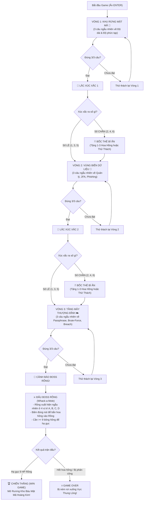

# 🎮 VỆ BINH MẬT KHẨU - CYBERSEC PASSWORD GUARDIAN
> **Game Pixel về Độ Mạnh Mật Khẩu (Password Strength) chạy trên NodeJS kết nối 5 nút bấm Arduino**  
> *Đồng hành và phát triển: **Trường THCS Nguyễn Bỉnh Khiêm** × **SoftLab***

---

## 🌟 TỔNG QUAN DỰ ÁN
Dự án được xây dựng theo phong cách **Retro Pixel Art 16-bit Arcade** kết hợp hiệu ứng âm thanh 8-bit sống động, phục vụ cho việc học tập, triển lãm hoặc sự kiện an ninh mạng tương tác với phần cứng vật lý qua Arduino.
Tích hợp logo thương hiệu pixel của **Trường THCS Nguyễn Bỉnh Khiêm** và **SoftLab**.

### 🎯 Điểm nổi bật:
- **Công nghệ**: Chạy hoàn toàn bằng **NodeJS** (Express + WebSocket + SerialPort) và HTML5 Canvas Pixel Engine.
- **Câu hỏi & Dữ liệu Random**: Mỗi lượt chơi đều sinh câu hỏi ngẫu nhiên và **dữ liệu mật khẩu hoàn toàn ngẫu nhiên** (độ dài, ký tự đặc biệt, tên người dùng, kịch bản Phishing, Passphrase...).
- **Hỗ trợ 5 nút bấm vật lý Arduino**: Nút **A**, **B**, **C**, **D** và **ENTER**.
- **Hỗ trợ song song Bàn phím máy tính**: Phím `A`, `B`, `C`, `D` và `ENTER` / `SPACE` trên bàn phím PC giúp kiểm thử ngay lập tức mà không bắt buộc phải có sẵn phần cứng.

---

## 🕹️ LUẬT CHƠI CHI TIẾT



### 1. 3 Vòng Chơi (Rừng - Nước - Mây)
- **Vòng 1: Khu Rừng Mật Mã (Forest)**: Nguyên tắc cơ bản tạo mật khẩu (Độ dài, ký tự hoa/thường/số/ký tự đặc biệt, phát hiện mật khẩu yếu, rủi ro ngày sinh/tên riêng).
- **Vòng 2: Vùng Biển Dữ Liệu (Water)**: Cạm bẫy lừa đảo Phishing giả mạo ngân hàng/mạng xã hội, bảo vệ bằng Xác thực 2 bước (2FA), dùng Trình quản lý mật khẩu (Password Manager), wifi công cộng.
- **Vòng 3: Tầng Mây Thượng Đỉnh (Cloud)**: Khái niệm Passphrase (Cụm mật khẩu), tấn công vét cạn Brute-force & số lượng tổ hợp, rò rỉ cơ sở dữ liệu (Data Breach) và tấn công nhồi thông tin (Credential Stuffing).

### 2. Điểm thưởng Hoa hồng & Xúc xắc - Thẻ bài
- Mỗi câu đúng: **+1 Bông Hồng** 🌹 (Sai câu nào: **0 Bông Hồng**).
- Trả lời đúng cả 3 câu thì pass màn.
- Sau mỗi màn: **Lắc Xúc Xắc (1-6)**:
  - **Số Lẻ (1, 3, 5)**: Đường đi an toàn, tiếp tục vào vòng sau.
  - **Số Chẵn (2, 4, 6)**: Kích hoạt **Bốc Thẻ Ma Thuật**:
    - *Kho Báu Mũ Trắng*: Tặng **+1** hoa hồng.
    - *Tường Lửa Hoàng Kim*: Tặng **+2** hoa hồng.
    - *Thần Hộ Mệnh 2FA*: Tặng **+3** hoa hồng.
    - *Bão Mã Độc*: Rơi mất **-1** hoa hồng.

### 3. Trận Đánh Boss Rồng (Final Boss Battle)
- Boss Rồng có **9 Máu (HP)**. Người chơi cần tích lũy tối thiểu **$\ge 9$ bông hồng** để có đủ hỏa lực tiêu diệt Boss!
- Rồng xuất hiện ngẫu nhiên ở 1 trong 4 cổng tương ứng với 4 nút:
  - **Vị trí [A]**: Cổng trên bên trái
  - **Vị trí [B]**: Cổng trên bên phải
  - **Vị trí [C]**: Cổng dưới bên trái
  - **Vị trí [D]**: Cổng dưới bên phải
- Mỗi lần Rồng xuất hiện, thanh thời gian phản xạ giảm dần. Người chơi phải bấm nhanh nút tương ứng (A, B, C, D) để phóng hoa hồng bắn trúng Rồng (cơ chế bắn bia / whack-a-mole).
- **Nếu bắn trúng 9 lần**: Rồng tan biến, mở bung **Rương Kho Báu Mật Mã Hoàng Kim** rực rỡ $\rightarrow$ **CHIẾN THẮNG!**
- **Nếu hết hoa hồng mà Rồng chưa chết**: Rồng khạc lửa hất tung người chơi rơi thẳng xuống **Thung Lũng vực thẳm** $\rightarrow$ **GAME OVER!**

---

## 🔌 SƠ ĐỒ ĐẤU DÂY ARDUINO (WIRING DIAGRAM)

Dự án sử dụng cơ chế **`INPUT_PULLUP`** của Arduino, do đó **KHÔNG CẦN BẤT KỲ ĐIỆN TRỞ RỜI NÀO**!
Bạn chỉ cần nối trực tiếp 5 nút bấm cơ (nút bấm arcade hoặc nút nhấn 2 chân) như sau:

| Tên Nút Bấm | Chân Trên Arduino | Chân Còn Lại Của Nút | Chức Năng Trong Game |
| :--- | :---: | :---: | :--- |
| **Nút A** | **Chân D2** | **GND** | Chọn đáp án A / Bắn Boss ở vị trí A |
| **Nút B** | **Chân D3** | **GND** | Chọn đáp án B / Bắn Boss ở vị trí B |
| **Nút C** | **Chân D4** | **GND** | Chọn đáp án C / Bắn Boss ở vị trí C |
| **Nút D** | **Chân D5** | **GND** | Chọn đáp án D / Bắn Boss ở vị trí D |
| **Nút ENTER** | **Chân D6** | **GND** | Bắt đầu, Mở cửa, Lắc xúc xắc, Bốc thẻ bài, Tiếp tục |

> 💡 *Gợi ý: Tất cả chân thứ 2 của 5 nút bấm có thể nối chụm lại với nhau rồi cắm vào 1 chân `GND` bất kỳ trên bo mạch Arduino.*

---

## 🚀 HƯỚNG DẪN CÀI ĐẶT & CHẠY GAME

### Bước 1: Nạp Code vào Arduino
1. Mở phần mềm **Arduino IDE**.
2. Mở file [arduino/CyberSec_Controller.ino](file:///c:/Users/peter/Downloads/CyberSecGame/arduino/CyberSec_Controller.ino).
3. Chọn đúng loại Board (Arduino Uno, Nano, Mega,...) và Cổng COM.
4. Bấm nút **Upload** (Mũi tên sang phải) để nạp code.

### Bước 2: Chạy Game trên Máy Tính
Mở Terminal / PowerShell tại thư mục dự án và chạy lệnh:
```bash
npm start
```
*(hoặc `node server.js`)*

### Bước 3: Trải nghiệm Game
- Mở trình duyệt web (Google Chrome, Edge, Cốc Cốc...) và truy cập:
  **`http://localhost:3000`**
- Server sẽ **tự động quét và kết nối với Arduino**. Bạn cũng có thể chọn cổng COM từ menu thả xuống trên cùng màn hình.
- Có thể chơi hoàn toàn bằng 5 nút bấm Arduino hoặc dùng bàn phím máy tính (`A`, `B`, `C`, `D`, `ENTER`).
